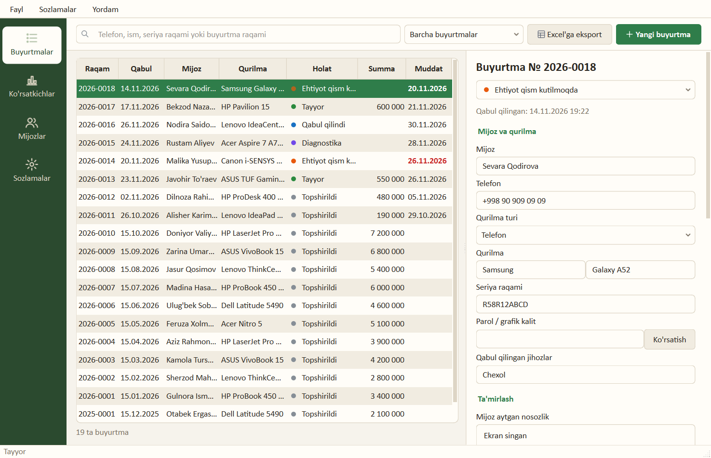
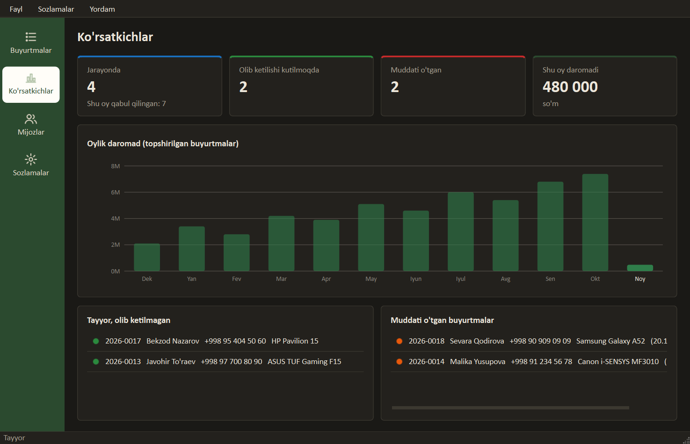
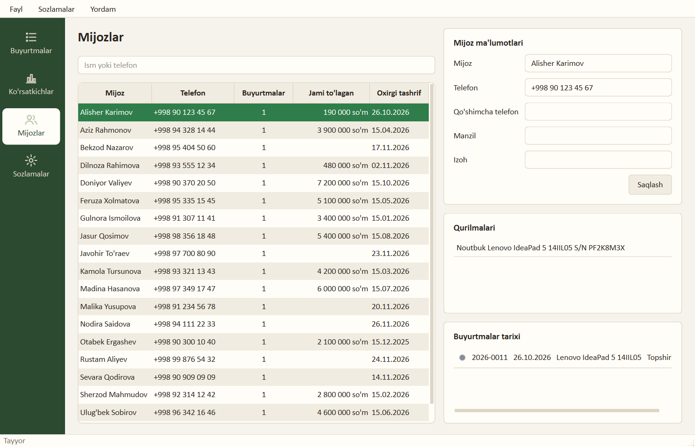
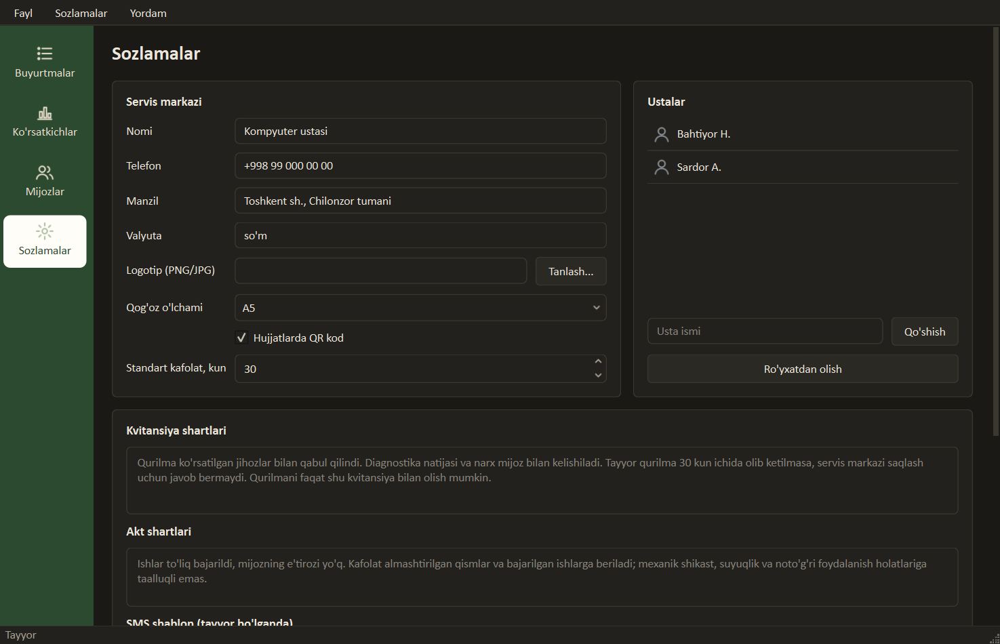

<h1 align="center">Servis jurnali</h1>

<b>Repair Shop Journal</b> · Журнал сервиса

   
  
  
  
  

Kompyuter va texnika ta'mirlash ustaxonasi uchun jurnal: mijozlar, qurilmalar, buyurtmalar holati, ehtiyot qismlar, qabul kvitansiyasi va bajarilgan ishlar akti (PDF, QR kod), daromad ko'rsatkichlari, SMS matni va Excel eksport.

## Imkoniyatlar

- Buyurtmalar: qabul, diagnostika, ehtiyot qism kutilmoqda, tayyor, topshirildi
- Mijoz va qurilma: brend, model, seriya raqami, yashirin parol, qabul qilingan jihozlar
- Ehtiyot qismlar narxi, ish haqi, oldindan to'lov va kafolat muddati
- Qabul kvitansiyasi va bajarilgan ishlar akti: PDF (A5/A4), logotip, QR kod
- Ko'rsatkichlar: jarayondagi, tayyor, muddati o'tgan buyurtmalar, oylik daromad grafigi
- Telefon, ism, seriya raqami bo'yicha qidiruv
- SMS uchun tayyor matn (nusxalash)
- Excel eksport, ma'lumotlar bazasi zaxirasi (avtomatik ham)
- O'zbek, rus, ingliz tillari; yorug' va qorong'i mavzu

## O'rnatish

1. [**ServisJurnali.exe**](https://github.com/eduhakimov/servis-jurnali/releases/latest/download/ServisJurnali.exe) faylini yuklab oling.
2. Faylni ishga tushiring — o'rnatish shart emas.
3. Windows SmartScreen ogohlantirsa: **Batafsil → Baribir ishga tushirish**.

**Tizim talablari:** Windows 10 (1809+) / Windows 11, x64

---

## Русский

Журнал для мастерской по ремонту компьютеров и техники: клиенты, устройства, статусы заказов, запчасти, квитанция о приёме и акт выполненных работ (PDF, QR-код), показатели выручки, текст SMS и экспорт в Excel.

- Заказы: принят, диагностика, ожидает запчасть, готов, выдан
- Клиент и устройство: бренд, модель, серийный номер, скрытый пароль, комплектация
- Стоимость запчастей и работ, предоплата, срок гарантии
- Квитанция о приёме и акт выполненных работ: PDF (A5/A4), логотип, QR-код
- Показатели: в работе, готовы, просрочены, график выручки по месяцам
- Поиск по телефону, имени, серийному номеру
- Готовый текст SMS (копирование)
- Экспорт в Excel, резервная копия базы (в том числе автоматическая)
- Узбекский, русский, английский; светлая и тёмная тема

## English

A journal for computer and electronics repair shops: clients, devices, order statuses, parts, intake receipts and completion certificates (PDF with QR code), revenue dashboard, SMS text and Excel export.

- Orders: received, diagnosis, waiting for parts, ready, delivered
- Client and device: brand, model, serial number, hidden password, accessories
- Parts and labor prices, prepayment, warranty period
- Intake receipt and completion certificate: PDF (A5/A4), logo, QR code
- Dashboard: in progress, ready, overdue orders and a monthly revenue chart
- Search by phone, name or serial number
- Ready-to-send SMS text (copy)
- Excel export and database backup (including automatic)
- Uzbek, Russian and English interface; light and dark themes

---

## Muallif / Author

**Bahtiyorjon Hakimov** (Hakimov Bahtiyorjon Muzaffar o'g'li) — [github.com/eduhakimov](https://github.com/eduhakimov)

© 2026 Bahtiyorjon Hakimov. Barcha huquqlar himoyalangan. / Все права защищены. / All rights reserved.
Batafsil: [LICENSE](LICENSE) · Uchinchi tomon komponentlari: [THIRD_PARTY_NOTICES.md](THIRD_PARTY_NOTICES.md)
