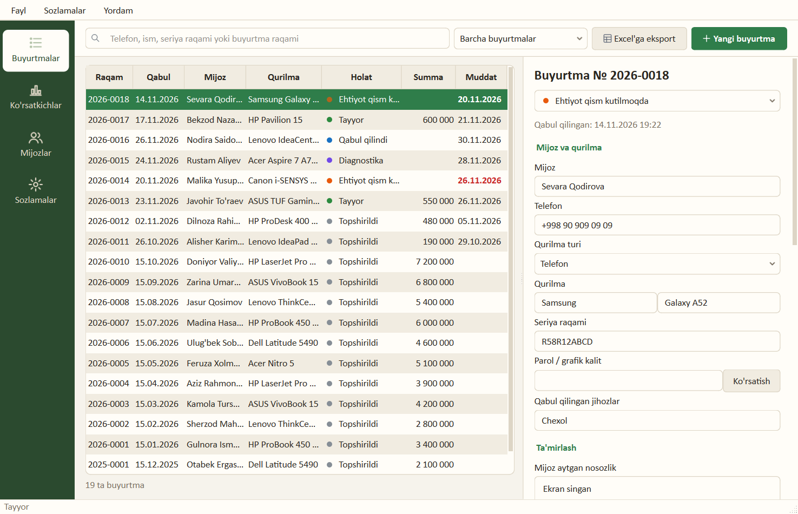
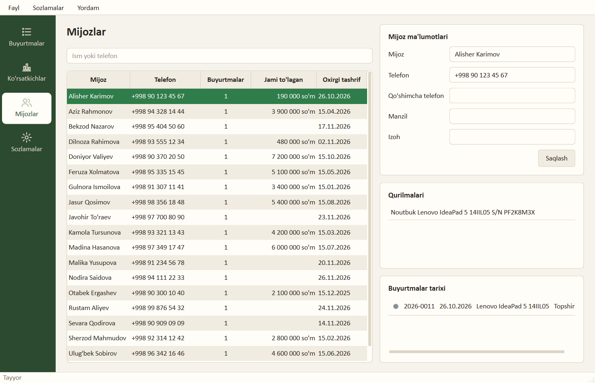
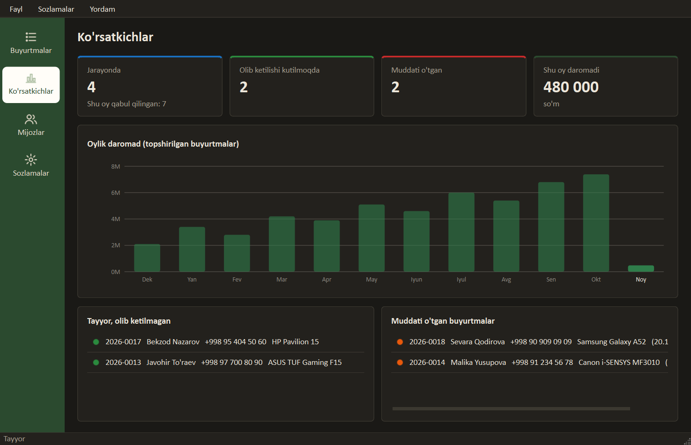
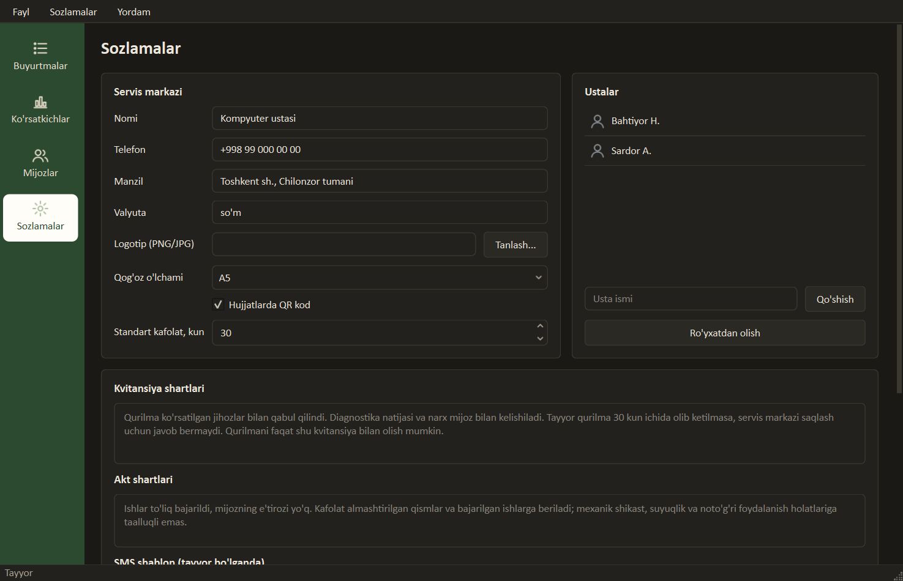

# Servis jurnali: Foydalanish qo‘llanmasi

Muallif: Hakimov Bahtiyorjon. Versiya: 1.0.2.

## 1. Umumiy ma’lumot

“Servis jurnali” kompyuter va texnika ta’mirlash ustaxonasi uchun elektron jurnal. U mijozlar va ularning qurilmalarini, buyurtmalar holatini, ehtiyot qismlar va to‘lovlarni yuritadi, qabul kvitansiyasi va bajarilgan ishlar aktini PDF ko‘rinishida tayyorlaydi, mijozga yuborish uchun SMS matnini nusxalaydi va ustaxona daromadini ko‘rsatadi.

Asosiy imkoniyatlar:

- buyurtma holatlari: qabul qilindi, diagnostika, ehtiyot qism kutilmoqda, tayyor, topshirildi;
- mijoz va qurilma: brend, model, seriya raqami, yashirin ko‘rsatiladigan parol, qabul qilingan jihozlar;
- ehtiyot qismlar narxi, ish haqi, oldindan to‘lov va kafolat muddati;
- qabul kvitansiyasi va bajarilgan ishlar akti: PDF (A5 yoki A4), logotip, QR kod;
- ko‘rsatkichlar: jarayondagi, tayyor, muddati o‘tgan buyurtmalar, oylik daromad grafigi;
- telefon, ism, seriya raqami bo‘yicha qidiruv;
- SMS uchun tayyor matn;
- Excel eksport, ma’lumotlar bazasi zaxirasi (avtomatik ham);
- o‘zbek, rus va ingliz tillari, yorug‘ va qorong‘i mavzu.
Dastur ustaxona egalari, ustalar va qabul bo‘limi xodimlari uchun mo‘ljallangan.

Ushbu qo‘llanmada dasturni yuklab olish va birinchi sozlash, oynaning tuzilishi, qurilmani qabul qilishdan topshirishgacha bo‘lgan amallar, sozlamalar, ma’lumotlarni saqlash tartibi va tez-tez uchraydigan savollarga javoblar bayon etilgan. Tugma va bo‘lim nomlari dasturning o‘zbekcha interfeysidagidek berilgan.

## 2. Tizim talablari

- Operatsion tizim: Windows 10 (1809 va undan keyingi versiyalar) yoki Windows 11, 64 bitli.
- Internet aloqasi talab qilinmaydi.
- O‘rnatish shart emas: dastur bitta bajariladigan fayldan iborat.
- Kvitansiya va aktlarni qog‘ozga chiqarish uchun printer, PDF fayllarni ko‘rish uchun PDF ko‘ruvchi dastur kerak bo‘ladi.
Dastur ishlashi uchun ma’lumotlar bazasi serveri, internet orqali ro‘yxatdan o‘tish yoki qo‘shimcha dasturlar talab etilmaydi: barcha zarur komponentlar bajariladigan fayl ichida joylashgan.

## 3. O‘rnatish va ishga tushirish

1. Dasturning GitHub sahifasidagi (https://github.com/eduhakimov/servis-jurnali) Releases bo‘limidan bajariladigan faylni yuklab oling.
2. Faylni qulay papkaga joylashtiring va ikki marta bosib ishga tushiring.
3. Birinchi ishga tushirishda Windows SmartScreen “Windows kompyuteringizni himoya qildi” ogohlantirishini ko‘rsatishi mumkin. Bu imzolanmagan dasturlar uchun odatiy holat: “Batafsil” havolasini, so‘ng “Baribir ishga tushirish” tugmasini bosing.
4. Birinchi sozlash: “Sozlamalar” bo‘limida servis markazi nomi, telefoni, manzili, valyuta va (ixtiyoriy) logotipni kiriting, ustalar ro‘yxatini to‘ldiring va “Sozlamalarni saqlash” tugmasini bosing. Bu ma’lumotlar kvitansiya va aktlarda chiqadi.
Dasturni yangilash uchun yangi versiyani yuklab olib, eski faylni almashtiring. Ma’lumotlar bazasi foydalanuvchi profilida saqlangani sababli yangilashda yo‘qolmaydi.

Dasturni o‘chirish uchun bajariladigan faylni o‘chirish kifoya; ma’lumotlar bazasi bunda saqlanib qoladi. Agar ma’lumotlar ham kerak bo‘lmasa, avval zaxira nusxa olib, so‘ng %APPDATA%\BahtiyorSoft\servis-jurnali papkasini qo‘lda o‘chiring.

## 4. Dastur oynasi bilan tanishish

Oynaning yuqorisida menyu satri (“Fayl”, “Sozlamalar”, “Yordam”), chap tomonda esa to‘rt bo‘limli panel joylashgan:

- **Buyurtmalar** – qidiruv, filtr, buyurtmalar jadvali va tanlangan buyurtma tafsilotlari;
- **Ko‘rsatkichlar** – jarayondagi, tayyor va muddati o‘tgan buyurtmalar soni, shu oy daromadi, 12 oylik grafik;
- **Mijozlar** – mijozlar jadvali, mijoz ma’lumotlari, qurilmalari va buyurtmalar tarixi;
- **Sozlamalar** – servis markazi ma’lumotlari, hujjatlar, ustalar, SMS shabloni va zaxira.
Pastdagi holat satrida saqlash va boshqa amallar natijasi haqida xabarlar chiqadi.

“Buyurtmalar” bo‘limining o‘ng panelidagi buyurtma tafsilotlari to‘rt guruhga bo‘lingan: “Mijoz va qurilma”, “Ta’mirlash”, “Ehtiyot qismlar” va “Hisob-kitob”. Panel pastida “Kvitansiya”, “Akt”, “SMS matni” tugmalari, buyurtmani o‘chirish va saqlash tugmalari hamda “Holatlar tarixi” joylashgan. Jadvalda holat rangli nuqta bilan ko‘rsatiladi, muddati o‘tgan buyurtmalarning muddati qizil rangda chiqadi.

*1-rasm. “Buyurtmalar” bo‘limi: qidiruv va filtr, buyurtmalar jadvali, o‘ngda tanlangan buyurtma tafsilotlari*

*2-rasm. “Mijozlar” bo‘limi: mijozlar jadvali va tanlangan mijoz ma’lumotlari*

## 5. Asosiy amallar

**Qurilmani qabul qilish**

1. “Buyurtmalar” bo‘limida “Yangi buyurtma” tugmasini bosing.
2. Telefon raqamini kiriting. Mijoz bazada bo‘lsa, uning ismi va oxirgi qurilmasi avtomatik to‘ldiriladi.
3. Mijoz ismini (yangi mijoz bo‘lsa), qurilma turini, brend, model, seriya raqami, parol yoki grafik kalit, qabul qilingan jihozlar (masalan, quvvat bloki, chexol) va mijoz aytgan nosozlikni yozing.
4. Kerak bo‘lsa usta, tayyor bo‘lish muddati va oldindan to‘lovni kiriting.
5. Saqlang. Buyurtma raqami beriladi va dastur qabul kvitansiyasini chop etishni taklif qiladi. Rozilik bersangiz, PDF kvitansiya yaratiladi va ochiladi.
**Ta’mirlash jarayonini yuritish**

1. Jadvaldan buyurtmani tanlang. Tafsilotlar o‘ng panelda ochiladi.
2. Panel yuqorisidagi holat ro‘yxatidan yangi holatni tanlang: “Diagnostika”, “Ehtiyot qism kutilmoqda”, “Tayyor” yoki “Topshirildi”.
3. “Diagnostika natijasi” va “Bajarilgan ishlar” maydonlarini to‘ldiring.
4. “Ehtiyot qismlar” bo‘limida “Qism qo‘shish” tugmasi bilan qism nomi, soni va narxini kiriting; noto‘g‘ri qatorni “Qismni o‘chirish” bilan olib tashlang.
5. “Ish haqi” va kerak bo‘lsa “Kafolat, kun” qiymatini kiriting. “To‘lash kerak” summasi avtomatik hisoblanadi.
6. “Saqlash” tugmasini bosing. Holatlar tarixi panel pastida ko‘rinadi.
**Mijozga xabar tayyorlash**

“SMS matni” tugmasini bosing. Buyurtma holatiga mos matn almashinuv buferiga nusxalanadi va holat satrida “SMS matni nusxalandi” xabari chiqadi. Matnni telefoningiz yoki messenjeringizga joylab yuboring.

**Bajarilgan ishlar aktini chiqarish**

Ta’mirlash tugagach “Akt” tugmasini bosing. Aktda bajarilgan ishlar, ehtiyot qismlar, summa va kafolat muddati ko‘rsatiladi. PDF fayl “Hujjatlar\Servis jurnali” papkasiga saqlanadi va avtomatik ochiladi; uni chop etib, mijoz bilan imzolang.

**Qidirish va filtrlash**

1. Yuqoridagi qidiruv maydoniga telefon, ism, seriya raqami, model yoki buyurtma raqamini yozing.
2. Filtr ro‘yxatidan “Barcha buyurtmalar”, “Jarayondagilar”, “Muddati o‘tganlar” yoki aniq holatni tanlang.
**Ko‘rsatkichlarni ko‘rish**

“Ko‘rsatkichlar” bo‘limida jarayondagi, olib ketilishi kutilayotgan va muddati o‘tgan buyurtmalar soni, shu oy daromadi va 12 oylik grafik ko‘rsatiladi. Daromad faqat topshirilgan buyurtmalar bo‘yicha hisoblanadi. Ro‘yxatdagi buyurtmani ikki marta bossangiz, u ochiladi.

**Mijozlar bilan ishlash**

“Mijozlar” bo‘limida ism yoki telefon bo‘yicha qidiring, mijozni tanlab ma’lumotlarini (qo‘shimcha telefon, manzil, izoh) o‘zgartiring va “Saqlash” ni bosing. “Qurilmalari” va “Buyurtmalar tarixi” bloklarida mijozning barcha qurilmalari va buyurtmalari ko‘rinadi.

**Excel ga eksport**

Excel faylining standart nomi buyurtmalar so‘zi va bugungi sanadan iborat. Eksportdan oldin qidiruv yoki filtr qo‘llasangiz, faylga faqat ko‘rinib turgan buyurtmalar yoziladi.

“Excel’ga eksport” tugmasini bosing va fayl nomini tasdiqlang. Joriy ro‘yxat xlsx fayliga yoziladi.

**Buyurtmani o‘chirish**

Buyurtmani tanlab, o‘chirish tugmasini bosing va so‘rovni tasdiqlang. Buyurtma uning ehtiyot qismlari va holatlar tarixi bilan birga butunlay o‘chiriladi.

**Namunaviy ish kuni**

Ish kuni boshida “Ko‘rsatkichlar” bo‘limida muddati o‘tgan va olib ketilishi kutilayotgan buyurtmalarni ko‘rib chiqing. Qurilma qabul qilinganda darhol buyurtma yarating va kvitansiya bering. Har bir holat o‘zgarganda uni dasturda belgilang va kerak bo‘lsa mijozga SMS matnini yuboring. Qurilma topshirilganda “Topshirildi” holatini tanlab, aktni chop eting.

*3-rasm. “Ko‘rsatkichlar” bo‘limi (qorong‘i mavzu): kartalar, oylik daromad grafigi va ro‘yxatlar*

## 6. Sozlamalar

“Sozlamalar” bo‘limida quyidagilar sozlanadi. O‘zgarishlardan keyin “Sozlamalarni saqlash” tugmasini bosing.

- **Servis markazi:** “Nomi”, “Telefon”, “Manzil”, “Valyuta”, “Logotip (PNG/JPG)” (“Tanlash...” tugmasi bilan), “Qog‘oz o‘lchami” (A5 yoki A4), “Hujjatlarda QR kod” belgisi, “Standart kafolat, kun”.
- **Ustalar:** “Usta ismi” maydoniga ism yozib “Qo‘shish” tugmasini bosing; ishdan ketgan ustani tanlab “Ro‘yxatdan olish” ni bosing.
- **Kvitansiya shartlari** va **Akt shartlari:** hujjatlarda chiqadigan shartlar matni.
- **SMS shablon (tayyor bo‘lganda):** o‘rinbosarlar {name}, {device}, {number}, {total}, {shop}, {phone} bilan o‘z matningiz. Bo‘sh qoldirilsa, standart matn ishlatiladi.
- **Ma’lumotlar bazasi:** baza fayli yo‘li, “Zaxira nusxa olish” tugmasi, “Har yopilganda avtomatik zaxira (oxirgi 10 ta)” belgisi va “Ma’lumotlar papkasini ochish” tugmasi.
Interfeys tili (O‘zbekcha, Русский, English) va mavzu (Yorug‘, Qorong‘i, Tizim bo‘yicha) menyu satridagi “Sozlamalar” menyusidan tanlanadi; tilni almashtirish dasturni qayta ishga tushiradi.

Servis markazi ma’lumotlari va hujjat shartlari dastur bazasida saqlanadi, shuning uchun bazaning zaxira nusxasi bilan birga ko‘chadi. Kafolat muddatini har bir buyurtmada alohida o‘zgartirish mumkin; standart qiymat faqat yangi buyurtmalarga qo‘llanadi.

*4-rasm. “Sozlamalar” bo‘limi: servis markazi ma’lumotlari, ustalar, kvitansiya va akt shartlari*

## 7. Ma’lumotlarni saqlash va xavfsizlik

- Barcha ma’lumotlar %APPDATA%\BahtiyorSoft\servis-jurnali papkasidagi “servis.db” faylida saqlanadi. Dastur internetga ulanmaydi.
- Dastur yopilganda (avtomatik zaxira yoqilgan bo‘lsa) bazaning nusxasi shu papkadagi “backups” papkasiga saqlanadi, oxirgi 10 ta nusxa qoldiriladi. Qo‘shimcha nusxani “Zaxira nusxa olish” tugmasi bilan istalgan joyga saqlash mumkin.
- Baza fayli buzilgan bo‘lsa, dastur uni chetga olib, oxirgi avtomatik zaxiradan tiklaydi va bu haqda xabar beradi. Zaxira topilmasa, yangi bo‘sh baza ochiladi, eski fayl esa yonida saqlab qo‘yiladi.
- Qurilma paroli oynada yulduzchalar bilan ko‘rsatiladi va “Ko‘rsatish” tugmasi bosilgandagina ochiladi. Bazada parol shifrlanmagan holda saqlanadi, shuning uchun ustaxona kompyuteriga parol qo‘ying va baza faylini begona shaxslarga bermang.
- PDF kvitansiya va aktlar “Hujjatlar\Servis jurnali” papkasida saqlanadi.
- Mijozlarning telefon raqamlari va boshqa ma’lumotlari shaxsiy ma’lumotlar hisoblanadi; ularni faqat xizmat ko‘rsatish maqsadida ishlating.
- Muhim ma’lumotlarni yo‘qotmaslik uchun haftasiga kamida bir marta qo‘lda zaxira nusxa olib, uni boshqa diskda yoki xotira qurilmasida saqlang.

## 8. Ko‘p uchraydigan savollar va muammolar

**Mijoz bazada bor, lekin avtomatik topilmadi.** Telefon raqamida kamida 7 ta raqam bo‘lishi kerak; dastur oxirgi 9 raqam bo‘yicha qidiradi. Raqam mijoz kartasida boshqa ko‘rinishda saqlangan bo‘lsa, “Mijozlar” bo‘limida uni tekshiring.

**“Mijoz ismini kiriting.” yoki “Nosozlikni yozing.” xabari chiqdi.** Yangi buyurtma uchun mijoz ismi va nosozlik majburiy maydonlar hisoblanadi.

**Kvitansiyada logotip chiqmayapti.** “Sozlamalar” bo‘limida logotip faylini (PNG yoki JPG) qayta tanlang va sozlamalarni saqlang.

**Daromad grafigida buyurtma ko‘rinmayapti.** Daromad faqat “Topshirildi” holatidagi buyurtmalar bo‘yicha, topshirilgan oy bo‘yicha hisoblanadi.

**Buyurtma muddati o‘tgan deb ko‘rsatilyapti.** Jarayondagi buyurtmaning tayyor bo‘lish muddati o‘tgan. Muddatni yangilang yoki holatni o‘zgartiring.

**SMS avtomatik yuborilmadi.** Dastur SMS yubormaydi, faqat matnni nusxalaydi; uni o‘zingiz yuborasiz.

**Dastur ishga tushganda baza tiklangani haqida xabar chiqdi.** Bu baza fayli shikastlanganini bildiradi. Oxirgi o‘zgarishlarni tekshiring; eski fayl ma’lumotlar papkasida saqlab qo‘yilgan.

**SmartScreen dasturni ishga tushirishga ruxsat bermayapti.** “Batafsil” havolasini, so‘ng “Baribir ishga tushirish” tugmasini bosing. Faylni faqat rasmiy GitHub sahifasidan yuklab oling.

**Kafolat muddati aktda ko‘rinmayapti.** “Kafolat, kun” maydoni nolga teng bo‘lmasligi va buyurtma tayyor yoki topshirilgan bo‘lishi kerak: kafolat tugash sanasi shu sanalardan hisoblanadi.

**Ma’lumotlarni yangi kompyuterga qanday ko‘chiraman?** Eski kompyuterda “Zaxira nusxa olish” bilan fayl yarating. Yangi kompyuterda dasturni bir marta ishga tushirib yoping, so‘ng zaxira faylini “servis.db” nomi bilan ma’lumotlar papkasiga ko‘chiring.

**Dastur kutilmagan xato haqida xabar berdi.** Xato tafsilotlari ma’lumotlar papkasidagi jurnal fayliga yoziladi. Muammo takrorlansa, shu faylni GitHub sahifasi orqali muallifga yuboring.

