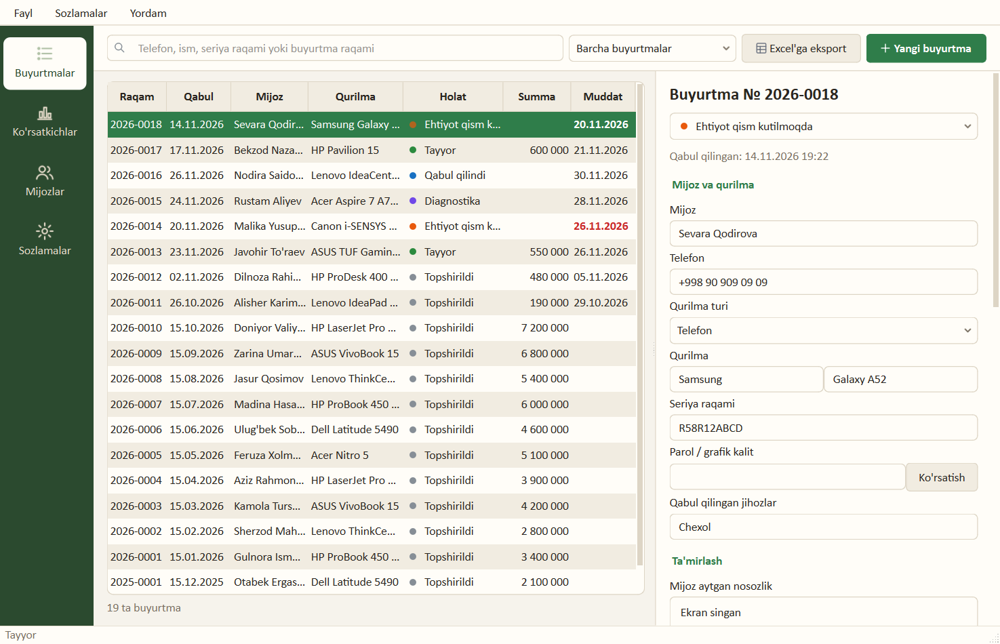
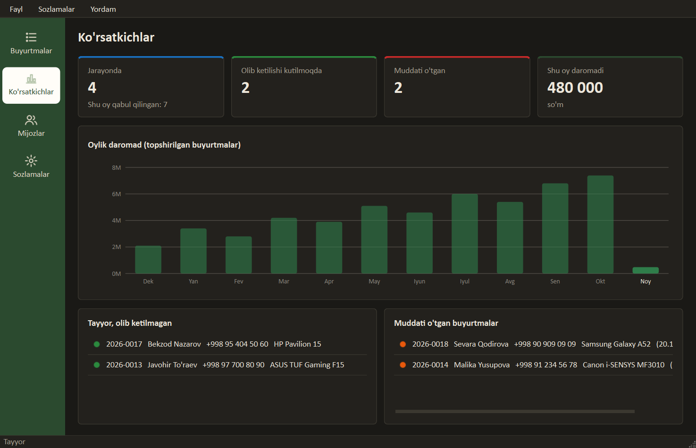
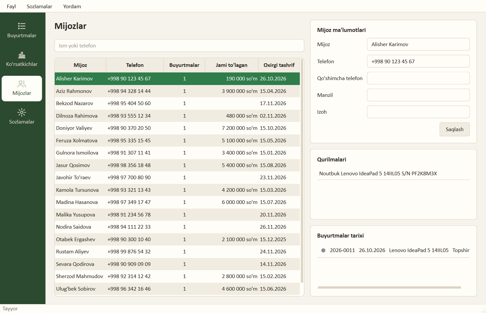
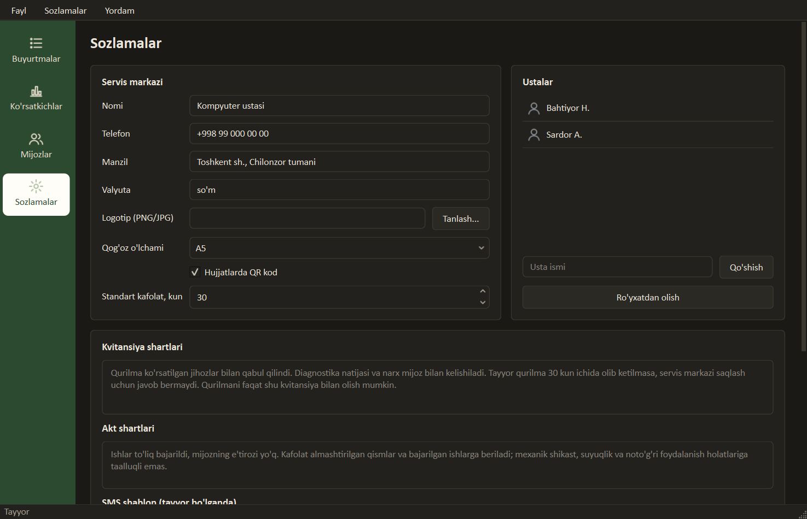

UDK: 004.42:004.65

# Kompyuter texnikasini ta’mirlash ustaxonasi uchun buyurtmalarni hisobga olish va hujjatlashtirish axborot tizimi: ma’lumotlar modeli, arxitektura va amalga oshirish

**Hakimov Bahtiyorjon**  
*[ish joyi, lavozimi, elektron pochta]*

**Annotatsiya.** Maqolada kompyuter va maishiy texnika ta’mirlash ustaxonalari uchun mo‘ljallangan “Servis jurnali” stol dasturi tavsiflanadi. Dastur mijozlar, qurilmalar, ustalar, buyurtmalar, ehtiyot qismlar va holatlar tarixini o‘zaro bog‘langan SQLite bazasida yuritadi. Buyurtma qabul qilish, diagnostika, ehtiyot qism kutish, tayyor va topshirildi bosqichlaridan o‘tadi, har bir o‘tish vaqt belgisi bilan qayd etiladi. Dastur qabul kvitansiyasi va bajarilgan ishlar aktini QR kod va logotip bilan A5 yoki A4 formatidagi PDF ko‘rinishida tayyorlaydi, mijozga yuborish uchun SMS matnini shakllantiradi, oylik daromad grafigini ko‘rsatadi, Excel eksport va avtomatik zaxira nusxani ta’minlaydi. Dastur Python 3.12 va PySide6 asosida yaratilgan va internetsiz ishlaydi.

*Kalit so‘zlar:* ta’mirlash ustaxonasi, buyurtmalar hisobi, servis xizmati, qabul kvitansiyasi, QR kod, SQLite, PySide6.

**Информационная система учёта и документирования заказов для мастерской по ремонту компьютерной техники: модель данных, архитектура и реализация**

**Аннотация.** В статье описывается настольная программа «Servis jurnali» для мастерских по ремонту компьютерной и бытовой техники. Программа ведёт в связанной базе SQLite клиентов, устройства, мастеров, заказы, запчасти и историю статусов. Заказ проходит этапы приёма, диагностики, ожидания запчасти, готовности и выдачи, каждый переход фиксируется с отметкой времени. Программа формирует квитанцию о приёме и акт выполненных работ в формате PDF (A5 или A4) с QR-кодом и логотипом, готовит текст SMS для клиента, показывает график месячного дохода, обеспечивает экспорт в Excel и автоматическое резервное копирование. Программа создана на Python 3.12 и PySide6 и работает без интернета.

*Ключевые слова:* ремонтная мастерская, учёт заказов, сервисное обслуживание, квитанция о приёме, QR-код, SQLite, PySide6.

**An Information System for Recording and Documenting Orders in a Computer Repair Workshop: Data Model, Architecture and Implementation**

**Abstract.** The paper describes “Servis jurnali”, a desktop program for computer and electronics repair workshops. It keeps clients, devices, technicians, orders, spare parts and status history in a related SQLite database. An order passes through the stages received, diagnosis, waiting for parts, ready and delivered, and each transition is logged with a timestamp. The program produces an intake receipt and a certificate of completed work as A5 or A4 PDF documents with a QR code and logo, prepares SMS text for the customer, shows a monthly revenue chart, and provides Excel export and automatic backups. The program is built with Python 3.12 and PySide6 and works offline.

*Keywords:* repair workshop, order tracking, service management, intake receipt, QR code, SQLite, PySide6.

## Kirish

Kompyuter, noutbuk, printer va mobil qurilmalarni ta’mirlash xizmatlari kichik va o‘rta biznesning keng tarqalgan yo‘nalishlaridan biridir. Bunday ustaxonada har kuni bir nechta qurilma qabul qilinadi, ularning har biri diagnostika, ehtiyot qism buyurtma qilish, ta’mirlash va mijozga topshirish bosqichlaridan o‘tadi. Har bir bosqichda aniq ma’lumot talab etiladi: qurilma kimga tegishli, u qanday holatda va qaysi jihozlar bilan qabul qilingan, qanday nosozlik aytilgan, qaysi qismlar almashtirilgan, qancha to‘lov olingan va kafolat qachongacha amal qiladi.

Ushbu ma’lumotlar daftarda yoki tarqoq fayllarda yuritilganda qurilmani yo‘qotish, mijoz bilan nizoli vaziyatlar, kafolat muddatini aniqlay olmaslik va daromadni noto‘g‘ri hisoblash xavfi paydo bo‘ladi. Qabul kvitansiyasi va bajarilgan ishlar aktining mavjudligi esa xizmat ko‘rsatish madaniyati va mijoz ishonchining muhim omili hisoblanadi.

“Raqamli O‘zbekiston – 2030” strategiyasida tadbirkorlik subyektlari faoliyatiga raqamli texnologiyalarni joriy etish, xizmat ko‘rsatish sohasini raqamlashtirish vazifalari belgilangan. Kichik ta’mirlash ustaxonalari uchun mahalliy tilda ishlaydigan, internetga bog‘liq bo‘lmagan va qo‘shimcha infratuzilma talab qilmaydigan hisob tizimi ana shu vazifalarni amalga oshirishning amaliy vositasidir.

Mazkur maqolada kompyuter texnikasini ta’mirlash ustaxonasi uchun ishlab chiqilgan “Servis jurnali” dasturi taqdim etiladi. Tadqiqot obyekti sifatida ta’mirlash buyurtmasining hayot sikli, predmeti sifatida esa uni hisobga oluvchi va hujjatlashtiruvchi dasturiy vositaning ma’lumotlar modeli, holatlar modeli, hujjatlar shakllantirish va ma’lumotlar xavfsizligi mexanizmlari olingan. Maqolada dasturning manba kodi, avtomatik testlari va foydalanuvchi interfeysi tahlil qilinadi.

Maqolaning tuzilishi quyidagicha: dastlab masala qo‘yilib, mavjud yechim turlari tahlil qilinadi; so‘ngra ma’lumotlar modeli, buyurtma holatlari, hisob-kitob qoidalari va ma’lumotlar xavfsizligi mexanizmlari bayon etiladi; keyin amalga oshirilgan funksiyalar va avtomatik testlar ko‘rib chiqiladi; yakunda yechimning afzalliklari, cheklovlari va rivojlantirish istiqbollari muhokama qilinadi.

## Muammoning qo‘yilishi va mavjud yechimlar tahlili

Masalani quyidagicha ifodalash mumkin. Ustaxona mijozlar va ularning qurilmalari haqidagi ma’lumotlarni qayta-qayta kiritmasdan yuritishi, har bir buyurtmani noyob raqam bilan ro‘yxatga olishi, uning holatini bosqichlar bo‘yicha kuzatishi va har bir o‘zgarish vaqtini saqlashi kerak. Buyurtma bo‘yicha ehtiyot qismlar va ish haqi asosida umumiy summa, oldindan to‘lovni hisobga olgan holda esa to‘lanishi kerak bo‘lgan qoldiq hisoblanishi, kafolat muddati topshirish sanasidan boshlab aniqlanishi lozim. Bundan tashqari, mijozga beriladigan qabul kvitansiyasi va bajarilgan ishlar akti, mijozga yuboriladigan xabar matni, ustaxona rahbari uchun ko‘rsatkichlar va daromad grafigi, shuningdek ma’lumotlarning zaxira nusxasi talab etiladi.

Amaliyotda bu masala quyidagi yechim turlari bilan hal qilinadi:

- Qog‘oz jurnallar va qo‘lda to‘ldiriladigan kvitansiyalar. Ular qo‘shimcha vosita talab qilmaydi, ammo qidiruv, hisob-kitob va statistika qo‘lda bajariladi, ma’lumotlar yo‘qolishi mumkin.
- Umumiy maqsadli elektron jadvallar. Ular hisob-kitobni qisman avtomatlashtiradi, lekin mijoz, qurilma va buyurtma o‘rtasidagi bog‘lanishlar, holatlar tarixi va hujjat shakllantirish qo‘lda tashkil etiladi.
- Bulutli servis markazlarini boshqarish tizimlari. Ular keng imkoniyatlarga ega, ammo doimiy internet aloqasi, obuna to‘lovi va mijozlarning shaxsiy ma’lumotlarini uchinchi tomon serverida saqlashni talab qiladi.
- Savdo va ombor hisobi dasturlari. Ular tovar aylanmasiga yo‘naltirilgan bo‘lib, ta’mirlash buyurtmasining bosqichlari, qurilmaning seriya raqami, qabul qilingan jihozlar va kafolat kabi o‘ziga xos ma’lumotlarni to‘liq qamramaydi.
Tahlil asosida ishlab chiqilayotgan vositaga quyidagi talablar qo‘yildi: ma’lumotlarni ustaxona kompyuterida bitta faylda saqlash; internetsiz ishlash; mijoz va qurilmani telefon raqami bo‘yicha tez topish; buyurtma holatlari va ularning tarixi; ehtiyot qismlar va hisob-kitob; PDF kvitansiya va akt; SMS matni; ko‘rsatkichlar va daromad grafigi; Excel eksport; avtomatik zaxira va buzilgan bazani tiklash; o‘zbek tilidagi interfeys.

## Tadqiqot metodologiyasi va dasturiy arxitektura

Dastur Python 3.12 tilida yozilgan. Grafik interfeys PySide6 (Qt 6) yordamida qurilgan, ma’lumotlar standart sqlite3 moduli orqali SQLite bazasida saqlanadi. PDF hujjatlar Qt ning matnli hujjat (QTextDocument) va PDF yozish (QPdfWriter) vositalari bilan yaratiladi, QR kod qrcode kutubxonasi yordamida hosil qilinadi, Excel fayllari openpyxl orqali yoziladi. Dastur PyInstaller yordamida bitta bajariladigan faylga yig‘iladi.

Manba kodi to‘rt asosiy moduldan iborat: ma’lumotlar bazasi moduli (sxema, mijozlar, qurilmalar, ustalar, buyurtmalar, qismlar, holatlar, statistika, zaxira va tiklash), hujjatlar moduli (kvitansiya va akt matni, PDF, QR kod, SMS matni, Excel eksport), interfeys yordamchilari va asosiy oyna. Baza va hujjatlar moduli interfeysdan mustaqil va alohida testlanadi. Umumiy yordamchi to‘plam (uzkit) sozlamalar, uch tilli matnlar, mavzu va xatolar jurnalini ta’minlaydi.

Ma’lumotlar modeli. Baza sakkizta jadvaldan iborat: mijozlar (ism, asosiy va qo‘shimcha telefon, manzil, izoh), qurilmalar (mijozga havola, turi, brend, model, seriya raqami, parol yoki grafik kalit, qabul qilingan jihozlar, izoh), ustalar (ism, telefon, faollik), buyurtmalar (raqam, mijoz, qurilma va usta havolalari, qabul sanasi, tayyor bo‘lish muddati, nosozlik, diagnostika natijasi, bajarilgan ishlar, ish haqi, oldindan to‘lov, holat, kafolat kunlari, tayyor bo‘lgan va topshirilgan vaqt, izoh), ehtiyot qismlar (buyurtmaga havola, nomi, soni, narxi), holatlar tarixi (buyurtma, holat, vaqt) va sozlamalar (kalit-qiymat). Qismlar va holatlar tarixi buyurtma o‘chirilganda kaskad tarzda o‘chiriladi. Telefon, holat va seriya raqami bo‘yicha qidiruvni tezlashtirish uchun indekslar yaratilgan. Qurilmalar mijozdan alohida jadvalda saqlangani tufayli bitta mijozning bir nechta qurilmasi va har bir qurilmaning ta’mirlash tarixi yuritiladi.

Buyurtma raqamlash. Buyurtma raqami “yil-tartib raqami” ko‘rinishida, tartib raqami to‘rt xonali qilib beriladi (masalan, 2026-0018). Har yil raqamlash qaytadan boshlanadi. Navbatdagi raqamni aniqlashda raqamlar matn sifatida emas, son sifatida saralanadi, shuning uchun to‘rt xonadan oshgan raqamlarda ham tartib buzilmaydi.

Holatlar modeli. Buyurtma beshta holatdan birida bo‘ladi: “Qabul qilindi”, “Diagnostika”, “Ehtiyot qism kutilmoqda”, “Tayyor”, “Topshirildi”. Birinchi uchtasi jarayondagi holatlar hisoblanadi. Holat o‘zgarganda o‘zgarish vaqti holatlar tarixiga yoziladi. Buyurtma birinchi marta “Tayyor” holatiga o‘tganda tayyor bo‘lgan vaqt, “Topshirildi” holatiga o‘tganda esa topshirilgan vaqt qayd etiladi; buyurtma qayta jarayondagi holatga qaytarilsa, topshirilgan vaqt tozalanadi. Jarayondagi buyurtmaning tayyor bo‘lish muddati bugungi sanadan oldin bo‘lsa, u muddati o‘tgan deb hisoblanadi.

Hisob-kitob qoidalari. Buyurtmaning umumiy summasi ish haqi va ehtiyot qismlar qiymati (soni ko‘paytirilgan narxi) yig‘indisiga, to‘lanishi kerak bo‘lgan summa esa umumiy summadan oldindan to‘lovni ayirganiga teng. Kafolat tugash sanasi topshirilgan (u bo‘lmasa, tayyor bo‘lgan) sanaga kafolat kunlarini qo‘shib aniqlanadi. Oylik daromad faqat topshirilgan buyurtmalar bo‘yicha, topshirilgan oy kesimida ish haqi va qismlar qiymati yig‘indisi sifatida hisoblanadi.

Mijozni aniqlash. Yangi buyurtmada telefon raqami kiritilganda dastur raqamdagi faqat raqamlarni ajratib oladi va kamida yetti raqam bo‘lsa, uning oxirgi to‘qqiz raqami bo‘yicha bazadagi asosiy yoki qo‘shimcha telefon bilan solishtiradi. Mijoz topilsa, uning ismi va oxirgi qurilmasi avtomatik to‘ldiriladi. Bu yondashuv raqamning “+998” prefiksi bilan yoki usiz, bo‘shliq va tirelar bilan yozilishidan qat’i nazar mijozni topish imkonini beradi.

Hujjatlarni shakllantirish. Kvitansiya va akt avval HTML ko‘rinishidagi matn sifatida tuziladi: unda servis markazi ma’lumotlari, buyurtma va mijoz ma’lumotlari kalit-qiymat jadvali ko‘rinishida, ehtiyot qismlar jadvali va imzo qatorlari joylashadi; foydalanuvchi kiritgan barcha matnlar HTML belgilaridan himoyalangan holda qo‘yiladi. So‘ngra matn Qt matnli hujjatiga yuklanadi va PDF yozuvchi orqali tanlangan qog‘oz o‘lchamida faylga chiqariladi. QR kod qrcode kutubxonasi yaratgan matritsa asosida rasmga aylantiriladi va hujjat sarlavhasiga joylashtiriladi; kutubxona mavjud bo‘lmasa, hujjat QR kodsiz yaratiladi. Bunday yondashuv tashqi PDF kutubxonalarisiz, faqat Qt vositalari bilan ishlash imkonini beradi.

SMS matni shakllantirishda holatga mos standart shablon yoki foydalanuvchi shabloni olinadi va undagi o‘rinbosarlar (mijoz ismi, qurilma, buyurtma raqami, to‘lov summasi, servis nomi va telefoni) haqiqiy qiymatlar bilan almashtiriladi. Shablonda noto‘g‘ri o‘rinbosar bo‘lsa, dastur xato bermaydi va shablon matnini o‘zgarishsiz qaytaradi. To‘lov summasi sifatida oldindan to‘lov bo‘lsa qoldiq, aks holda umumiy summa ko‘rsatiladi.

Ma’lumotlar xavfsizligi va ishonchliligi. Baza foydalanuvchi profilidagi ilova ma’lumotlari papkasida (%APPDATA%\BahtiyorSoft\servis-jurnali) saqlanadi; dastur kodida tarmoq so‘rovlari yo‘q. Dastur yopilganda (bu imkoniyat sozlamalarda yoqilgan bo‘lsa) SQLite zaxiralash interfeysi orqali bazaning izchil nusxasi alohida papkaga saqlanadi va oxirgi 10 ta nusxa qoldiriladi. Ishga tushishda bazaning butunligi tezkor tekshiruv bilan tekshiriladi; baza buzilgan bo‘lsa, u vaqt belgisi qo‘shilgan nom bilan chetga olinadi va eng yangi yaroqli avtomatik zaxiradan tiklanadi, zaxira bo‘lmasa yangi bo‘sh baza ochiladi; har ikki holatda foydalanuvchiga xabar beriladi. Qurilma paroli interfeysda yashirin belgilar bilan ko‘rsatiladi va “Ko‘rsatish” tugmasi bosilgandagina ochiladi; bazada esa u ochiq matn ko‘rinishida saqlanadi, shuning uchun baza faylining himoyasi kompyuterning umumiy himoyasiga bog‘liq.

## Amalga oshirish va asosiy funksiyalar

Asosiy oynaning chap qismida to‘rt bo‘limli navigatsiya paneli joylashgan: “Buyurtmalar”, “Ko‘rsatkichlar”, “Mijozlar” va “Sozlamalar”.

Interfeys qabul bo‘limi xodimining kundalik ish oqimiga moslashtirilgan: eng ko‘p bajariladigan amallar (qidiruv, yangi buyurtma, holatni o‘zgartirish, hujjat chiqarish) bitta bo‘limda, bir ekranda joylashgan. Buyurtma tanlanganda uning barcha ma’lumotlari o‘ng panelda tahrirlash uchun ochiladi, o‘zgarishlar “Saqlash” tugmasi bilan bazaga yoziladi.

“Buyurtmalar” bo‘limi. Yuqorida qidiruv maydoni (telefon, ism, seriya raqami, model yoki buyurtma raqami bo‘yicha), filtr (“Barcha buyurtmalar”, “Jarayondagilar”, “Muddati o‘tganlar” va holatlar), “Excel’ga eksport” va “Yangi buyurtma” tugmalari joylashgan. Jadvalda raqam, qabul sanasi, mijoz, qurilma, holat (rangli belgi bilan), summa va muddat ko‘rsatiladi; muddati o‘tgan buyurtmalar muddati qizil rangda ajratiladi. O‘ng panelda tanlangan buyurtma tafsilotlari: holat ro‘yxati, qabul vaqti, “Mijoz va qurilma” bo‘limi (mijoz, telefon, qurilma turi, brend va model, seriya raqami, parol, qabul qilingan jihozlar), “Ta’mirlash” bo‘limi (nosozlik, diagnostika natijasi, bajarilgan ishlar, usta, muddat, kafolat), “Ehtiyot qismlar” jadvali va “Hisob-kitob” bo‘limi (ish haqi, qismlar, oldindan to‘lov, to‘lash kerak). Panel pastida “Kvitansiya”, “Akt”, “SMS matni”, buyurtmani o‘chirish va saqlash tugmalari hamda holatlar tarixi joylashgan.

Yangi buyurtma oynasi. Oynada telefon raqami, mijoz ismi, qurilma turi (noutbuk, kompyuter, monoblok, monitor, printer, telefon, planshet, boshqa), brend, model, seriya raqami, parol yoki grafik kalit, qabul qilingan jihozlar, mijoz aytgan nosozlik, usta, tayyor bo‘lish muddati va oldindan to‘lov kiritiladi. Saqlangach buyurtma raqami beriladi va dastur qabul kvitansiyasini chop etishni taklif qiladi.

Hujjatlar. Qabul kvitansiyasida servis markazi nomi, telefoni, manzili va logotipi, buyurtma raqami va sanasi, mijoz va qurilma ma’lumotlari, qabul qilingan jihozlar, nosozlik, oldindan to‘lov, kvitansiya shartlari va imzo joylari bo‘ladi. Bajarilgan ishlar aktida bundan tashqari bajarilgan ishlar, ehtiyot qismlar jadvali, ish haqi, jami summa va kafolat muddati (kunlar va tugash sanasi) ko‘rsatiladi. Ikkala hujjatda ham sozlamalarga ko‘ra servis nomi, buyurtma raqami va telefonni o‘z ichiga olgan QR kod joylashtiriladi. Qog‘oz o‘lchami (A5 yoki A4) sozlamalarda tanlanadi, PDF fayllar “Hujjatlar” papkasidagi “Servis jurnali” papkasiga saqlanadi va avtomatik ochiladi.

SMS matni. “SMS matni” tugmasi buyurtma holatiga mos tayyor matnni (qabul qilindi, diagnostikada, ehtiyot qism kutilmoqda, tayyor, topshirildi) mijoz ismi, qurilma, buyurtma raqami, to‘lov summasi, servis nomi va telefoni bilan to‘ldirib, almashinuv buferiga nusxalaydi. “Tayyor” holati uchun foydalanuvchi o‘z shablonini o‘rinbosarlar yordamida yozishi mumkin; dastur SMS yubormaydi, faqat matnni tayyorlaydi.

“Ko‘rsatkichlar” bo‘limi. To‘rtta karta (“Jarayonda” – shu oy qabul qilinganlar soni bilan, “Olib ketilishi kutilmoqda”, “Muddati o‘tgan”, “Shu oy daromadi”), “Oylik daromad (topshirilgan buyurtmalar)” grafigi (oxirgi 12 oy) hamda “Tayyor, olib ketilmagan” va “Muddati o‘tgan buyurtmalar” ro‘yxatlari joylashgan; ro‘yxatdagi buyurtmani ikki marta bosish uni ochadi.

“Mijozlar” bo‘limi. Jadvalda mijoz, telefon, buyurtmalar soni, jami to‘lagan summa va oxirgi tashrif sanasi ko‘rsatiladi. O‘ng tomonda “Mijoz ma’lumotlari” (ism, telefon, qo‘shimcha telefon, manzil, izoh), “Qurilmalari” va “Buyurtmalar tarixi” bloklari joylashgan.

“Sozlamalar” bo‘limi. Unda servis markazi nomi, telefoni, manzili, valyuta, logotip (PNG yoki JPG), qog‘oz o‘lchami, “Hujjatlarda QR kod” belgisi, standart kafolat kunlari, ustalar ro‘yxati, kvitansiya va akt shartlari matni, SMS shabloni, zaxira nusxa olish, avtomatik zaxira belgisi va ma’lumotlar papkasini ochish vositalari joylashgan.

Interfeys tili (O‘zbekcha, Русский, English) va mavzu (Yorug‘, Qorong‘i, Tizim bo‘yicha) menyu satridagi “Sozlamalar” menyusi orqali tanlanadi.

*1-rasm. “Buyurtmalar” bo‘limi (namoyish ma’lumotlari): buyurtmalar jadvali, muddati o‘tgan sanalar qizil rangda, o‘ngda 2026-0018 raqamli buyurtma tafsilotlari*

*2-rasm. Qorong‘i mavzudagi “Ko‘rsatkichlar” bo‘limi: to‘rtta karta, oylik daromad grafigi va tayyor hamda muddati o‘tgan buyurtmalar ro‘yxatlari*

*3-rasm. “Mijozlar” bo‘limi: mijozlar jadvali, mijoz ma’lumotlari, qurilmalari va buyurtmalar tarixi*

*4-rasm. “Sozlamalar” bo‘limi: servis markazi ma’lumotlari, qog‘oz o‘lchami, QR kod, kafolat, ustalar ro‘yxati va hujjat shartlari*

## Sinov va natijalar

Dastur pytest asosidagi avtomatik testlar bilan tekshiriladi. Testlar uch faylda joylashgan 15 ta test funksiyasidan iborat.

- Mantiq testlari (9 ta). Ular buyurtma raqamlash va yaratishni, ehtiyot qismlar bo‘yicha summalar va holat o‘zgarishlarini, qidiruvni, filtrlar va ko‘rsatkichlarni, sozlamalar, zaxira nusxa va buyurtmani o‘chirishni, ustalar ro‘yxatini, summalarni formatlashni, namoyish ma’lumotlarini va hujjatlar (kvitansiya, akt, SMS, Excel) shakllantirilishini tekshiradi.
- Ssenariy testlari (4 ta). Ular ustaxonaning to‘liq ish kunini (qabul, diagnostika, qism qo‘shish, tayyor, topshirish, hujjatlar), yil davomida 9999 dan ortiq buyurtma bo‘lganda raqamlash tartibini, buzilgan bazaning avtomatik zaxiradan tiklanishini va zaxira bo‘lmaganda yangi baza ochilishini tekshiradi.
- Tutun testlari (2 ta). Ular asosiy oynaning yaratilishini va interfeys matnlarining uch tilda to‘liqligini tekshiradi.
Testlar vaqtinchalik papkadagi alohida bazada bajariladi va haqiqiy ustaxona ma’lumotlariga ta’sir qilmaydi. Buzilgan bazani tiklash testlari baza fayliga ataylab shikast yetkazib, dasturning keyingi ishga tushishdagi xatti-harakatini tekshiradi.

Qo‘llab-quvvatlanadigan imkoniyatlar quyidagicha jamlanishi mumkin: beshta buyurtma holati, sakkizta qurilma turi, ikki qog‘oz o‘lchami (A5 va A4), besh holat uchun standart SMS matni va “Tayyor” holati uchun foydalanuvchi shabloni, oxirgi 12 oylik daromad grafigi, oxirgi 10 ta avtomatik zaxira nusxa.

Dastur Windows 10 (1809 va undan keyingi versiyalar) hamda Windows 11 operatsion tizimlarining 64 bitli versiyalari uchun mo‘ljallangan. Interfeys o‘zbek, rus va ingliz tillarida mavjud. Hujjat formatlari: PDF (A5 yoki A4) va Excel (xlsx). Ishlash tezligi, ustaxonalarda joriy etish natijalari yoki foydalanuvchilar soni bo‘yicha o‘lchovlar o‘tkazilmagan, shu sababli maqolada bunday ko‘rsatkichlar keltirilmaydi.

## Muhokama

Dasturning afzalliklari quyidagilarda namoyon bo‘ladi. Birinchidan, mijoz, qurilma va buyurtma alohida, lekin bog‘langan obyektlar sifatida modellashtirilgani bir mijozning bir nechta qurilmasi va har bir qurilmaning ta’mirlash tarixini yuritish imkonini beradi. Ikkinchidan, holatlar tarixi buyurtma bilan nima va qachon sodir bo‘lganini tiklash imkonini beradi, bu mijoz bilan nizoli vaziyatlarda muhim. Uchinchidan, kvitansiya va aktning QR kod va logotip bilan avtomatik shakllantirilishi xizmat ko‘rsatish sifatini oshiradi. To‘rtinchidan, avtomatik zaxira va buzilgan bazani tiklash mexanizmi ma’lumotlar yo‘qolishi xavfini kamaytiradi.

Cheklovlar ham mavjud. Dastur bitta kompyuterda ishlash uchun mo‘ljallangan, bir nechta ish o‘rni o‘rtasida tarmoq orqali birgalikda ishlash ko‘zda tutilmagan. Qurilma paroli bazada shifrlanmagan holda saqlanadi, shuning uchun ustaxona kompyuteri parol bilan himoyalanishi va baza fayli begona shaxslarga berilmasligi kerak. SMS xabarlar dasturning o‘zi tomonidan yuborilmaydi, faqat matn tayyorlanadi. Ehtiyot qismlar ombori qoldiqlari yuritilmaydi. Hujjatlar fiskal yoki soliq hujjati o‘rnini bosmaydi.

Rivojlantirish istiqbollari sifatida ehtiyot qismlar ombori, bir nechta ish o‘rni uchun umumiy baza, qurilma parolini shifrlab saqlash, ustalar bo‘yicha hisobotlar va hujjat shablonlarini tahrirlash funksiyalarini qo‘shish ko‘rib chiqilishi mumkin.

Loyihaviy qarorlardan biri holat o‘zgarishlarini alohida jadvalda saqlashdir. Buyurtmaning joriy holati buyurtmalar jadvalida, butun tarix esa holatlar jurnalida turadi; bu tezkor filtrlash va ko‘rsatkichlarni hisoblashni soddalashtiradi va shu bilan birga har bir o‘zgarishni vaqt bo‘yicha tiklash imkonini beradi. Yana bir qaror buzilgan bazani tiklashda avtomatik zaxiradan foydalanishdir: foydalanuvchi qo‘lda zaxira olmagan bo‘lsa ham, dastur yopilganda olingan nusxa ma’lumotlarning katta qismini saqlab qoladi.

Ta’lim nuqtai nazaridan dastur kompyuter texnikasiga xizmat ko‘rsatish bo‘yicha kasbiy ta’limda ustaxona hujjat aylanishini o‘rgatish, ma’lumotlar bazalari fanida esa “bir-ko‘p” munosabatlar, holatlar tarixi va hisoblanadigan maydonlarni real misolda ko‘rsatish uchun qo‘llanilishi mumkin.

## Xulosa

Maqolada kompyuter texnikasini ta’mirlash ustaxonasi uchun ishlab chiqilgan “Servis jurnali” dasturining ma’lumotlar modeli, holatlar va hisob-kitob qoidalari, hujjatlarni shakllantirish va ma’lumotlar xavfsizligi mexanizmlari, arxitekturasi va funksiyalari bayon etildi. Dastur buyurtmaning qabul qilinishidan mijozga topshirilishigacha bo‘lgan butun hayot siklini qayd etadi, PDF kvitansiya va akt, SMS matni, ko‘rsatkichlar va daromad grafigini taqdim etadi, Excel eksport va avtomatik zaxirani ta’minlaydi.

Ishning amaliy natijasi shundan iboratki, ta’mirlash ustaxonasining qog‘oz jurnal va qo‘lda to‘ldiriladigan kvitansiyalarga asoslangan ish jarayoni yagona ma’lumotlar modeli, aniq holatlar ketma-ketligi va avtomatik shakllanadigan hujjatlar bilan almashtirildi. Mijozni telefon raqami bo‘yicha aniqlash, holatlar tarixini yuritish va buzilgan bazani zaxiradan tiklash kabi yechimlar boshqa xizmat ko‘rsatish sohalaridagi hisob tizimlarida ham qo‘llanilishi mumkin.

Asosiy funksiyalar va buzilgan bazani tiklash mexanizmi 15 ta avtomatik test bilan tasdiqlangan. Dastur internetsiz ishlaydi, interfeysi o‘zbek, rus va ingliz tillarida. U kompyuter va maishiy texnika ta’mirlash ustaxonalari, servis markazlari, shuningdek kasb-hunar ta’limi muassasalari tomonidan qo‘llanilishi mumkin. Dastur manbalari muallifning GitHub sahifasida joylashtirilgan.

## Foydalanilgan adabiyotlar

1. O‘zbekiston Respublikasi Prezidentining 2020-yil 5-oktabrdagi PF-6079-son “Raqamli O‘zbekiston – 2030” strategiyasini tasdiqlash va uni samarali amalga oshirish chora-tadbirlari to‘g‘risida”gi Farmoni.
2. Python Software Foundation. Python 3.12 Documentation [Elektron resurs]. – URL: https://docs.python.org/3.12/ (murojaat sanasi: 27.11.2026).
3. SQLite Consortium. SQLite Documentation [Elektron resurs]. – URL: https://www.sqlite.org/docs.html (murojaat sanasi: 27.11.2026).
4. The Qt Company. Qt for Python (PySide6) Documentation [Elektron resurs]. – URL: https://doc.qt.io/qtforpython-6/ (murojaat sanasi: 27.11.2026).
5. The Qt Company. QPdfWriter Class. Qt 6 Documentation [Elektron resurs]. – URL: https://doc.qt.io/qt-6/qpdfwriter.html (murojaat sanasi: 27.11.2026).
6. Loop L. python-qrcode: QR Code image generator [Elektron resurs]. – URL: https://github.com/lincolnloop/python-qrcode (murojaat sanasi: 27.11.2026).
7. ISO/IEC 18004:2015. Information technology – Automatic identification and data capture techniques – QR Code bar code symbology specification. – Geneva: ISO, 2015.
8. openpyxl Contributors. openpyxl Documentation [Elektron resurs]. – URL: https://openpyxl.readthedocs.io/en/stable/ (murojaat sanasi: 27.11.2026).
9. PyInstaller Development Team. PyInstaller Manual [Elektron resurs]. – URL: https://pyinstaller.org/en/stable/ (murojaat sanasi: 27.11.2026).
10. Hakimov B. Servis jurnali: manba kodi va bajariladigan fayl [Elektron resurs]. – URL: https://github.com/eduhakimov/servis-jurnali (murojaat sanasi: 27.11.2026).
