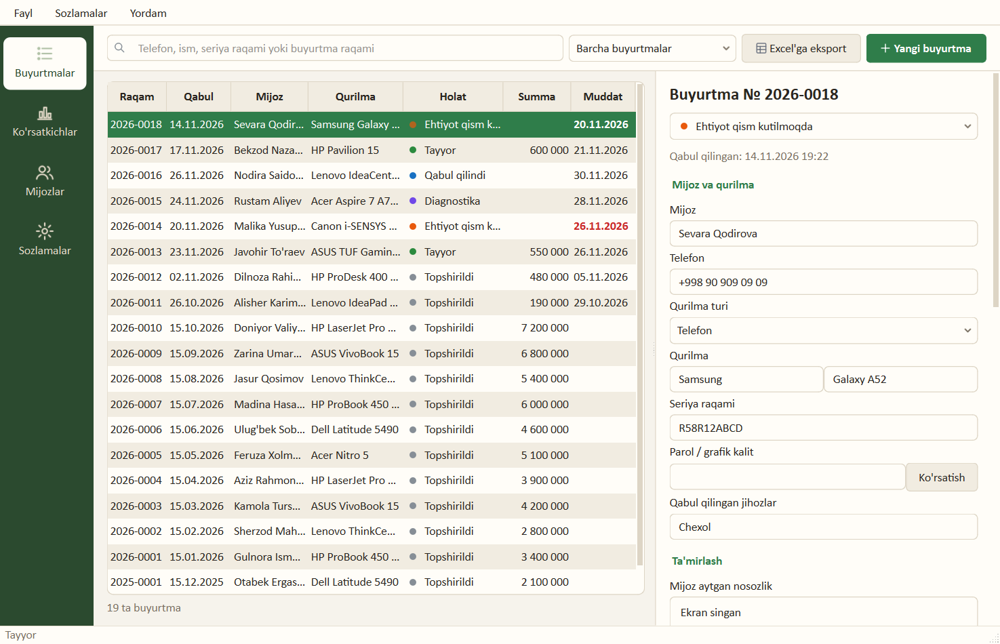
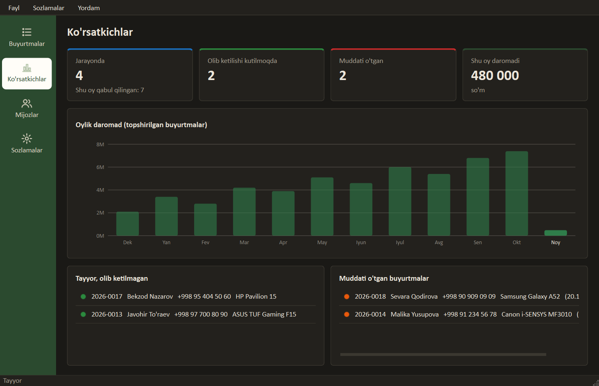

# Servis jurnali: Uslubiy ko‘rsatma

Muallif: Hakimov Bahtiyorjon. Versiya: 1.0.2.

## 1. Uslubiy ko‘rsatmaning maqsadi va vazifalari

Ushbu uslubiy ko‘rsatmaning maqsadi “Servis jurnali” dasturidan kompyuter texnikasiga xizmat ko‘rsatish, ma’lumotlar bazalari va kichik biznesni boshqarishga oid fanlarda o‘quv vositasi sifatida foydalanish tartibini belgilashdan iborat. Dastur talabalarga ta’mirlash ustaxonasining hujjat aylanishini (qabul, diagnostika, ta’mirlash, topshirish, kafolat) real vaziyatga yaqin sharoitda amalda o‘rgatish imkonini beradi.

Uslubiy ko‘rsatmaning vazifalari:

- dasturning imkoniyatlari va o‘quv jarayonidagi o‘rnini aniqlash;
- 80 daqiqalik amaliy mashg‘ulotning namunaviy rejasini taklif etish;
- dasturning haqiqiy funksiyalariga asoslangan amaliy topshiriqlar va kutilgan natijalarni berish;
- baholash mezonlari, nazorat savollari va mustaqil ish uchun tavsiyalarni shakllantirish;
- mijozlarning shaxsiy ma’lumotlari bilan ishlash madaniyati bo‘yicha qoidalarni eslatish.
Mashg‘ulot natijasida talaba ta’mirlash buyurtmasining hayot siklini tushuntira oladi, qurilmani qabul qilishda qaysi ma’lumotlar qayd etilishini biladi, buyurtma holatlarini to‘g‘ri yuritadi, ehtiyot qismlar va ish haqi asosida hisob-kitob qiladi, qabul kvitansiyasi va bajarilgan ishlar aktini tayyorlaydi, mijozga xabar matnini shakllantiradi.

Ko‘rsatma o‘qituvchiga mashg‘ulotni tayyorlash vaqtini qisqartirish, topshiriqlarni bosqichma-bosqich tashkil etish va talabalar faoliyatini yagona mezonlar asosida baholashda yordam beradi. Topshiriqlar guruhning tayyorgarlik darajasiga qarab qisqartirilishi yoki kengaytirilishi mumkin.

## 2. Qo‘llash sohasi va maqsadli auditoriya

Dasturdan quyidagi fanlar va mutaxassisliklarda foydalanish tavsiya etiladi:

- kollej va texnikumlarda “Kompyuter texnikasiga xizmat ko‘rsatish va ta’mirlash”, “Maishiy elektron texnikani ta’mirlash” yo‘nalishlaridagi kasbiy fanlar va ishlab chiqarish amaliyoti;
- oliy ta’lim muassasalarida “Ma’lumotlar bazasi”, “Axborot tizimlari” fanlari;
- “Kichik biznes va tadbirkorlik asoslari”, “Xizmat ko‘rsatish sohasini boshqarish” fanlari;
- kasb-hunar o‘quv markazlarida ta’mirlash ustasi kurslari;
- ta’mirlash ustaxonalari va servis markazlarida yangi xodimlarni o‘qitish.
Maqsadli auditoriya: o‘qituvchilar va ishlab chiqarish ta’limi ustalari, talabalar, kollej o‘quvchilari, shuningdek ustaxona egalari va xodimlari. Dastur bilan ishlash uchun kompyuterdan boshlang‘ich foydalanish ko‘nikmalari yetarli.

Kasbiy faoliyatda dastur kichik ta’mirlash ustaxonalari va servis markazlariga qog‘oz jurnaldan elektron hisobga o‘tish, qurilmalarni qabul qilish va topshirishni hujjatlashtirish, ustaxona daromadini kuzatish uchun xizmat qiladi. Mashg‘ulotni ta’mirlash texnologiyasi bo‘yicha asosiy mavzular o‘rganilgandan keyin o‘tkazish maqsadga muvofiq.

Vaziyatli topshiriqlar uchun o‘qituvchi o‘quv ustaxonasida haqiqatan ta’mirlanayotgan qurilmalardan (shaxsiy ma’lumotlarsiz) foydalanishi mumkin; bu nazariy bilimni amaliy ish bilan bog‘laydi.

Dastur interfeysi uch tilda bo‘lgani uchun uni o‘zbek, rus va ingliz tilida ta’lim olayotgan guruhlarda qo‘llash mumkin.

## 3. O‘quv mashg‘ulotida foydalanish tartibi

Quyida “Ta’mirlash ustaxonasida buyurtmalarni elektron hisobga olish” mavzusidagi 80 daqiqalik amaliy mashg‘ulot rejasi keltirilgan. Mashg‘ulotdan oldin o‘qituvchi kompyuterlarga dasturni joylashtiradi va har bir talabaga uch nafar shartli mijoz va ularning qurilmalari, nosozliklari va ta’mirlash natijalaridan iborat vaziyatli topshiriq kartasini tarqatadi.

1. Tashkiliy qism (5 daqiqa): davomatni tekshirish, mashg‘ulot maqsadi va kutilgan natijalarni e’lon qilish.
2. Nazariy qism (20 daqiqa): ta’mirlash buyurtmasining hayot sikli; qurilmani qabul qilishda qayd etiladigan ma’lumotlar (seriya raqami, jihozlar, nosozlik) va ularning nizoli vaziyatlardagi ahamiyati; buyurtma holatlari; ehtiyot qismlar, ish haqi, oldindan to‘lov va qoldiq; kafolat muddati; qabul kvitansiyasi va bajarilgan ishlar akti; mijoz ma’lumotlarini himoya qilish. O‘qituvchi dastur oynasini proyektorda namoyish qiladi.
3. Amaliy qism (45 daqiqa): talabalar vaziyatli topshiriq kartasi asosida 1–5-topshiriqlarni bajaradi.
4. Yakuniy qism (10 daqiqa): tayyorlangan kvitansiya va aktlarni ko‘rib chiqish, xatolarni muhokama qilish, uyga vazifa berish.
Nazariy qismda qurilmani qabul qilishda seriya raqami va qabul qilingan jihozlarni aniq yozishning ahamiyatini real vaziyat misolida ko‘rsatish tavsiya etiladi: masalan, mijoz qurilmani olib ketayotganda quvvat bloki qaytarilmagan deb da’vo qilsa, kvitansiyadagi yozuv nizoni hal etishga yordam beradi.

Amaliy qismni rolli o‘yin shaklida tashkil etish mumkin: bir talaba mijoz, ikkinchisi qabul bo‘limi xodimi rolini bajaradi; mijoz qurilma va nosozlikni og‘zaki tasvirlaydi, xodim esa ma’lumotlarni dasturga kiritadi va kvitansiya beradi. Keyingi topshiriqda rollar almashtiriladi. Bu usul qabul jarayonidagi muloqot madaniyatini ham shakllantiradi.

Mashg‘ulotga tayyorgarlik ko‘rishda o‘qituvchi dasturni oldindan sinab ko‘rishi, vaziyatli topshiriq kartalarini tayyorlashi va kutilgan hisob-kitob natijalarini hisoblab qo‘yishi tavsiya etiladi. Agar kompyuter sinfida dastur oldin ishlatilgan bo‘lsa, har bir talaba toza bazadan boshlashi uchun avvalgi ma’lumotlarni zaxiralab, ma’lumotlar papkasini tozalash kerak.

Mashg‘ulotda ulgurilmagan 6–8-topshiriqlar uy vazifasi sifatida beriladi va keyingi mashg‘ulot boshida tekshiriladi.

Mashg‘ulot oxirida o‘qituvchi o‘quv kompyuterlaridagi shartli ma’lumotlarni o‘chirish yoki zaxiralash tartibini talabalar bilan birga bajaradi.

*1-rasm. Mashg‘ulotda namoyish qilinadigan “Buyurtmalar” bo‘limi va buyurtma tafsilotlari*

*2-rasm. Mashg‘ulot yakunida tahlil qilinadigan “Ko‘rsatkichlar” bo‘limi*

## 4. Amaliy topshiriqlar

1. **Ustaxonani sozlash.** “Sozlamalar” bo‘limida shartli servis markazi nomi, telefoni, manzili, valyutani kiriting, ikki ustani qo‘shing va sozlamalarni saqlang. Kutilgan natija: ma’lumotlar saqlangan, ustalar ro‘yxatda ko‘rinadi.
2. **Qurilmani qabul qilish.** Vaziyatli kartadagi birinchi mijoz qurilmasini barcha maydonlar bilan qabul qiling va qabul kvitansiyasini PDF ko‘rinishida chiqaring. Kutilgan natija: buyurtma raqami berilgan, kvitansiyada mijoz, qurilma, jihozlar va nosozlik to‘g‘ri ko‘rsatilgan.
3. **Takroriy mijoz.** Birinchi mijozning telefon raqamini boshqa ko‘rinishda (masalan, bo‘shliqlar bilan) kiritib, ikkinchi buyurtmani yarating. Kutilgan natija: mijoz avtomatik topiladi, “Mijozlar” bo‘limida unda ikkita buyurtma ko‘rinadi.
4. **Ta’mirlash jarayoni.** Buyurtmani “Diagnostika” va “Ehtiyot qism kutilmoqda” holatlaridan o‘tkazing, diagnostika natijasini yozing, ikkita ehtiyot qism va ish haqini kiriting. Kutilgan natija: “To‘lash kerak” summasi qo‘lda hisoblangan qiymatga teng, holatlar tarixida har bir o‘tish vaqti ko‘rinadi.
5. **Topshirish va akt.** Buyurtmani “Tayyor”, so‘ng “Topshirildi” holatiga o‘tkazing va bajarilgan ishlar aktini chiqaring. Kutilgan natija: aktda qismlar, summa va kafolat tugash sanasi to‘g‘ri ko‘rsatilgan; buyurtma “Ko‘rsatkichlar” bo‘limidagi shu oy daromadiga qo‘shilgan.
6. **Mijozga xabar.** Har bir holatda “SMS matni” tugmasi bilan matn olib, ularni hisobotga joylang; “Tayyor” holati uchun o‘z SMS shabloningizni yozing. Kutilgan natija: holatga mos matnlar va o‘rinbosarlar to‘g‘ri almashtirilgan shablon.
7. **Muddat nazorati.** Uchinchi buyurtmaga o‘tgan sanadagi muddatni belgilang. Kutilgan natija: buyurtma “Muddati o‘tganlar” filtrida va “Ko‘rsatkichlar” bo‘limidagi ro‘yxatda ko‘rinadi.
8. **Eksport va zaxira.** Buyurtmalar ro‘yxatini Excel ga eksport qiling va bazaning zaxira nusxasini oling. Kutilgan natija: xlsx fayl va zaxira fayli; talaba avtomatik zaxira qanday ishlashini tushuntiradi.
Topshiriqlar bajarilgach, talaba qisqa hisobot tayyorlaydi: yaratilgan buyurtmalar raqamlari, holatlar ketma-ketligi, qo‘lda bajarilgan hisob-kitob va uning dastur natijasi bilan solishtirilishi, tayyorlangan hujjatlar (PDF fayllar) va SMS matnlari, xulosalar. 1–5-topshiriqlar mashg‘ulot vaqtida, 6–8-topshiriqlar mashg‘ulot oxirida yoki uy vazifasi sifatida bajariladi.

Tayyorgarligi yuqori guruhlarda o‘qituvchi qo‘shimcha topshiriq berishi mumkin: qog‘oz o‘lchamini A5 dan A4 ga o‘zgartirib, hujjatlar ko‘rinishini solishtirish va ustaxona uchun qaysi biri qulay ekanini asoslash; yoki kvitansiya shartlari matnini mijoz huquqlarini hisobga olgan holda qayta yozish.

## 5. Baholash mezonlari

Amaliy ish 100 ball bilan baholanadi:

- qurilmani to‘liq va aniq qabul qilish (barcha maydonlar, kvitansiya) – 20 ball;
- buyurtma holatlarini to‘g‘ri yuritish va holatlar tarixini izohlash – 15 ball;
- ehtiyot qismlar va hisob-kitob, qo‘lda tekshirish – 20 ball;
- bajarilgan ishlar akti va kafolat muddatini to‘g‘ri rasmiylashtirish – 15 ball;
- SMS matnlari, muddat nazorati, eksport va zaxira – 15 ball;
- nazorat savollariga javob va muhokamadagi ishtirok – 15 ball.
Baholash shkalasi: 86–100 ball “a’lo”, 71–85 ball “yaxshi”, 55–70 ball “qoniqarli”, 55 balldan kam “qoniqarsiz”. Hujjatlarda mijoz yoki qurilma ma’lumotlari noto‘g‘ri ko‘rsatilishi jiddiy xato hisoblanadi, chunki real ustaxonada bu nizoga sabab bo‘lishi mumkin.

Topshiriqlar natijalari (hisobot, PDF hujjatlar, xlsx fayl) elektron ko‘rinishda, talaba familiyasi yozilgan papkada topshiriladi. Kechikib topshirilgan ishlar uchun ball kamaytirish tartibi o‘qituvchi tomonidan oldindan e’lon qilinadi.

Guruhda yoki rolli o‘yin shaklida ishlaganda har bir talabaning hissasi alohida baholanadi.

Yakuniy ball mashg‘ulot oxirida yoki hisobot tekshirilgach e’lon qilinadi; talaba xatolarini tuzatib, ishni qayta topshirish imkoniyatiga ega.

## 6. Nazorat savollari

1. Ta’mirlash buyurtmasi qaysi holatlardan o‘tadi va qaysilari jarayondagi holat hisoblanadi?
2. Qurilmani qabul qilishda qaysi ma’lumotlarni qayd etish zarur va nima uchun?
3. Buyurtma raqami qanday shakllanadi?
4. “To‘lash kerak” summasi qanday hisoblanadi?
5. Kafolat muddati qaysi sanadan boshlab hisoblanadi?
6. Oylik daromadga qaysi buyurtmalar kiradi?
7. Dastur takroriy mijozni qanday aniqlaydi?
8. Qabul kvitansiyasi va bajarilgan ishlar aktining farqi nimada?
9. Avtomatik zaxira qachon olinadi va nechta nusxa saqlanadi?
10. Qurilma paroli qanday ko‘rsatiladi va saqlanadi, bu qanday xavfsizlik choralarini talab qiladi?
Nazorat savollari og‘zaki so‘rov, yozma test yoki mustaqil ish himoyasida qo‘llanilishi mumkin. 2, 4, 5 va 10-savollarga javob berishda talaba amaliy topshiriqlarda olgan natijalaridan misol keltirishi va dastur interfeysidagi nomlarni to‘g‘ri atashi tavsiya etiladi.

Javoblarni baholashda talabaning ustaxona hujjat aylanishini izchil tushuntira olishi va dastur interfeysidagi nomlarni to‘g‘ri atashi hisobga olinadi.

## 7. Mustaqil ish uchun tavsiyalar

- Ishlab chiqarish amaliyoti davomida (ustaxona roziligi bilan) bir hafta ichida qabul qilingan qurilmalarni shartli ma’lumotlar bilan dasturda yuriting va haftalik hisobot tayyorlang.
- Dastur ma’lumotlar modeliga mos ER-diagramma chizing va mijoz, qurilma va buyurtma o‘rtasidagi bog‘lanishlarni tushuntiring.
- O‘z ustaxonangiz uchun kvitansiya va akt shartlari matnini ishlab chiqing va uni dastur sozlamalariga kiriting.
- Ta’mirlash ustaxonasida mijozlarning shaxsiy ma’lumotlarini himoya qilish bo‘yicha qisqa yo‘riqnoma tayyorlang.
- QR kod texnologiyasi va uning hujjatlarda qo‘llanishi haqida qisqa referat yozing.
- Ustaxona uchun mijozga xizmat ko‘rsatish standartini (qabul, xabardor qilish, topshirish) ishlab chiqing va dasturdagi holatlar hamda SMS matnlarini shu standartga moslashtiring.
Mustaqil ish natijalari keyingi mashg‘ulotda qisqa taqdimot shaklida himoya qilinadi.

Himoya jarayonida talaba o‘z ishining asosiy xulosalarini va uni real ustaxonada qo‘llash bo‘yicha takliflarini qisqa bayon qiladi.

## 8. Xavfsizlik va axborot madaniyati qoidalari

Ta’mirlash ustaxonasi mijozlarning shaxsiy ma’lumotlari va qurilmalaridagi ma’lumotlarga kirish imkoniyatiga ega bo‘ladi, shuning uchun mashg‘ulotda talabalarga quyidagi qoidalarni tushuntirish va ularga rioya etilishini nazorat qilish tavsiya etiladi:

- O‘quv mashg‘ulotlarida faqat shartli mijoz ma’lumotlaridan foydalaning; haqiqiy shaxslarning telefon raqamlari va qurilma parollarini kiritmang.
- Real ustaxonada qurilma parolini faqat ta’mirlash uchun zarur bo‘lsa so‘rang, uni begona shaxslarga ko‘rsatmang; ish tugagach mijozga parolni o‘zgartirishni tavsiya qiling.
- Ustaxona kompyuterini parol bilan himoyalang, baza fayli va zaxira nusxalarini xavfsiz joyda saqlang.
- Mijoz qurilmasidagi shaxsiy fayllarni ko‘rmang va nusxalamang; bu kasbiy etikaning asosiy talabidir.
- Dasturni faqat muallifning rasmiy GitHub sahifasidan yuklab oling.
- Kompyuterda uzoq ishlaganda har 45–50 daqiqada qisqa tanaffus qiling, ta’mirlash ishlarida elektr xavfsizligi qoidalariga rioya qiling.
